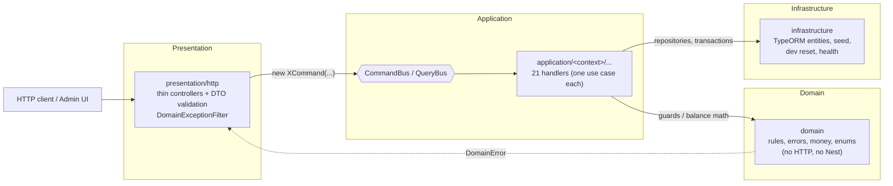
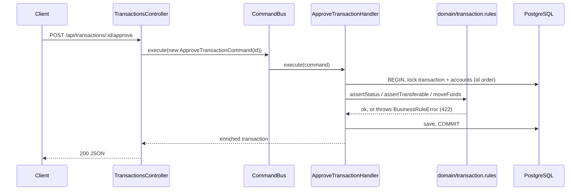

# Architecture - step 02: use cases (CQRS)

Same REST contract as step 01, different insides. Every controller action of the fat version became
one **use case**: a plain Command/Query class plus one handler, one folder each (`@nestjs/cqrs`).
Controllers are now a thin presentation layer. The rules that were copy-pasted between controller methods
live once in `src/domain`.

## Layers



Dependency rule: presentation -> application -> domain. Handlers also use TypeORM directly (repositories/`DataSource`);
that is a conscious shortcut for the demo, not a proper port/adapter split.

## Folder layout

```
src/
  domain/                    enums.ts, money.ts (integer cents), errors/, account.rules.ts,
                             customer.rules.ts, transaction.rules.ts (four-eyes, transfer, approve, reject, reverse)
  application/
    customers/{queries,commands}/<use-case>/<use-case>.{query|command}.ts + .handler.ts
    accounts/ ...   transactions/ (+ shared/transaction-item.ts read model)   reports/
    index.ts                 USE_CASE_HANDLERS (registered in AppModule)
  presentation/http/         customers|accounts|transactions|reports .controller.ts, dto/, domain-exception.filter.ts
  infrastructure/            persistence/ (entities, numeric transformer, account locks), seed/, dev/, health/
```

## Request flow (Approve a pending transfer)



## Errors

| Domain error | HTTP | Typical case |
|---|---|---|
| `NotFoundError` | 404 | customer/account/transaction does not exist (also when referenced in a body) |
| `ConflictError` | 409 | duplicate email, customer delete blocked |
| `BusinessRuleError` | 422 | frozen/closed account, insufficient funds, KYC not verified, wrong status for approve/reject/reverse |
| `ValidationError` | 400 | reserved for domain-level validation (input DTO validation is still done by class-validator -> 400) |

One filter (`presentation/http/domain-exception.filter.ts`) turns them into Nest's `{statusCode, message, error}`.
Messages are the same text as in step 01.

## Use-case catalogue (21)

| Context | Queries | Commands | HTTP |
|---|---|---|---|
| customers | `ListCustomers`, `GetCustomer` | `CreateCustomer`, `UpdateCustomer`, `SetKycStatus`, `DeleteCustomer` | `GET/POST/PATCH/DELETE /customers...`, `POST /customers/:id/kyc` |
| accounts | `ListAccounts`, `GetAccount` | `OpenAccount`, `FreezeAccount`, `UnfreezeAccount`, `CloseAccount` | `/accounts...`, `POST /accounts/:id/freeze\|unfreeze\|close` |
| transactions | `ListTransactions`, `GetTransaction` | `Deposit`, `Withdraw`, `Transfer`, `ApproveTransaction`, `RejectTransaction`, `ReverseTransaction` | `/transactions...` |
| reports | `GetSummaryReport` | - | `GET /reports/summary` |

Not use cases (infrastructure): `POST /dev/reset`, `GET /health`, seed.

## What got deduplicated

| Step 01 (fat) | Step 02 |
|---|---|
| "account must be ACTIVE" copied into deposit, withdraw, transfer, approve, reverse | `assertActive` in `domain/account.rules.ts` |
| "Insufficient funds ..." message copied 5 times | `assertSufficientFunds` |
| Transfer and approve both re-implement "both ACTIVE + same currency + funds + move money" | `assertTransferable` + `moveFunds` in `domain/transaction.rules.ts` |
| Four-eyes threshold constant inside a controller | `requiresFourEyes` / `FOUR_EYES_THRESHOLD_CENTS` in the domain |
| `NotFoundException` / `UnprocessableEntityException` thrown from 20+ places | domain errors + one exception filter |

## Why this prepares step 03

A use case no longer knows it is called over HTTP. Anything that can build a `Command`/`Query` and hand it to the bus
(a second controller, a queue consumer, an MCP tool) reuses the same logic. Step 03 adds exactly that.
