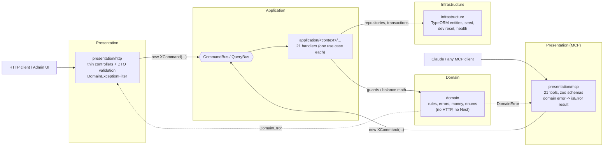
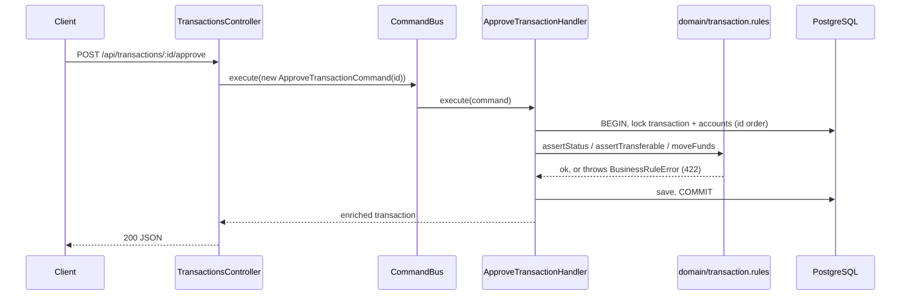
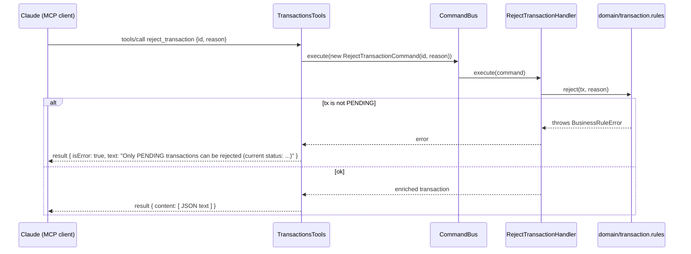

# Architecture - step 03: use cases (CQRS) + MCP

Same REST contract as step 01, different insides, plus a second presentation layer (MCP). Every controller action of the fat version became
one **use case**: a plain Command/Query class plus one handler, one folder each (`@nestjs/cqrs`).
Controllers are now a thin presentation layer. The rules that were copy-pasted between controller methods
live once in `src/domain`.

## Layers



Dependency rule: presentation (HTTP and MCP) -> application -> domain. Handlers also use TypeORM directly (repositories/`DataSource`);
that is a conscious shortcut for the demo, not a proper port/adapter split.

## Folder layout

```
src/
  domain/                    enums.ts, money.ts (integer cents), errors/, account.rules.ts,
                             customer.rules.ts, transaction.rules.ts (four-eyes, transfer, approve, reject, reverse)
  application/
    customers/{queries,commands}/<use-case>/<use-case>.{query|command}.ts + .handler.ts
    accounts/ ...   transactions/ (+ shared/transaction-item.ts read model)   reports/
    index.ts                 USE_CASE_HANDLERS (registered in AppModule)
  presentation/mcp/          customers|accounts|transactions|reports .tools.ts, schemas.ts (zod), tool-result.ts
  presentation/http/         customers|accounts|transactions|reports .controller.ts, dto/, domain-exception.filter.ts
  infrastructure/            persistence/ (entities, numeric transformer, account locks), seed/, dev/, health/
```

## Request flow (Approve a pending transfer)



## Errors

| Domain error | HTTP | Typical case |
|---|---|---|
| `NotFoundError` | 404 | customer/account/transaction does not exist (also when referenced in a body) |
| `ConflictError` | 409 | duplicate email, customer delete blocked |
| `BusinessRuleError` | 422 | frozen/closed account, insufficient funds, KYC not verified, wrong status for approve/reject/reverse |
| `ValidationError` | 400 | reserved for domain-level validation (input DTO validation is still done by class-validator -> 400) |

One filter (`presentation/http/domain-exception.filter.ts`) turns them into Nest's `{statusCode, message, error}`.
Messages are the same text as in step 01.

## Use-case catalogue (21)

| Context | Queries | Commands | HTTP |
|---|---|---|---|
| customers | `ListCustomers`, `GetCustomer` | `CreateCustomer`, `UpdateCustomer`, `SetKycStatus`, `DeleteCustomer` | `GET/POST/PATCH/DELETE /customers...`, `POST /customers/:id/kyc` |
| accounts | `ListAccounts`, `GetAccount` | `OpenAccount`, `FreezeAccount`, `UnfreezeAccount`, `CloseAccount` | `/accounts...`, `POST /accounts/:id/freeze\|unfreeze\|close` |
| transactions | `ListTransactions`, `GetTransaction` | `Deposit`, `Withdraw`, `Transfer`, `ApproveTransaction`, `RejectTransaction`, `ReverseTransaction` | `/transactions...` |
| reports | `GetSummaryReport` | - | `GET /reports/summary` |

Not use cases (infrastructure): `POST /dev/reset`, `GET /health`, seed.

## What got deduplicated

| Step 01 (fat) | Step 02 |
|---|---|
| "account must be ACTIVE" copied into deposit, withdraw, transfer, approve, reverse | `assertActive` in `domain/account.rules.ts` |
| "Insufficient funds ..." message copied 5 times | `assertSufficientFunds` |
| Transfer and approve both re-implement "both ACTIVE + same currency + funds + move money" | `assertTransferable` + `moveFunds` in `domain/transaction.rules.ts` |
| Four-eyes threshold constant inside a controller | `requiresFourEyes` / `FOUR_EYES_THRESHOLD_CENTS` in the domain |
| `NotFoundException` / `UnprocessableEntityException` thrown from 20+ places | domain errors + one exception filter |

## MCP presentation layer

`@rekog/mcp-nest` (v1.9.x, `McpModule.forRoot`, Streamable HTTP, stateless, JSON responses) exposes the use cases as MCP tools at
`http://localhost:3000/mcp`. The REST prefix is `api`; `app.setGlobalPrefix('api', { exclude: ['mcp'] })` keeps `/mcp` outside of it.

- One tool per use case, 21 in total, snake_case names: `list_customers`, `get_customer`, `create_customer`, `update_customer`,
  `set_kyc_status`, `delete_customer`, `list_accounts`, `get_account`, `open_account`, `freeze_account`, `unfreeze_account`,
  `close_account`, `list_transactions`, `get_transaction`, `deposit`, `withdraw`, `transfer`, `approve_transaction`,
  `reject_transaction`, `reverse_transaction`, `get_summary_report`.
- Inputs are zod schemas (LLM-oriented descriptions, enum values spelled out). List tools default to `limit` 10 (max 100).
- A tool does three things only: map arguments to the Command/Query -> `bus.execute` -> return JSON text.
- Domain errors become tool results with `isError: true` and the same message text REST returns, so the model can read the reason.
- `Dev reset` is deliberately not exposed over MCP.

### Same use case, two doors

```ts
// presentation/http/transactions.controller.ts  (REST)
@Post(':id/reject')
@HttpCode(200)
reject(@Param('id', ParseUUIDPipe) id: string, @Body() dto: RejectTransactionDto) {
  return this.commandBus.execute(new RejectTransactionCommand(id, dto.reason));
}

// presentation/mcp/transactions.tools.ts  (MCP)
@Tool({
  name: 'reject_transaction',
  description: 'Reject a PENDING transaction with a mandatory reason ... Only PENDING transactions can be rejected.',
  parameters: z.object({ id: uuid('Transaction id'), reason: z.string().trim().min(1).max(500) }),
})
rejectTransaction({ id, reason }: { id: string; reason: string }) {
  return runUseCase(() => this.commandBus.execute(new RejectTransactionCommand(id, reason)));
}
```

Both call `RejectTransactionHandler`. Nothing about "only PENDING can be rejected" is written in either of them; it is in
`domain/transaction.rules.ts`.



See `docs/MCP.md` for connecting Claude Code / Claude Desktop / MCP Inspector.
